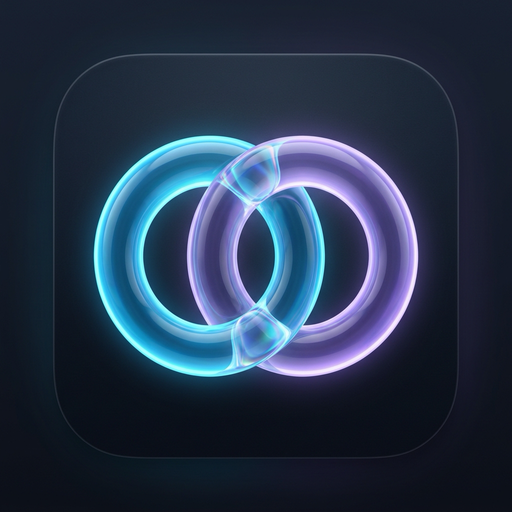
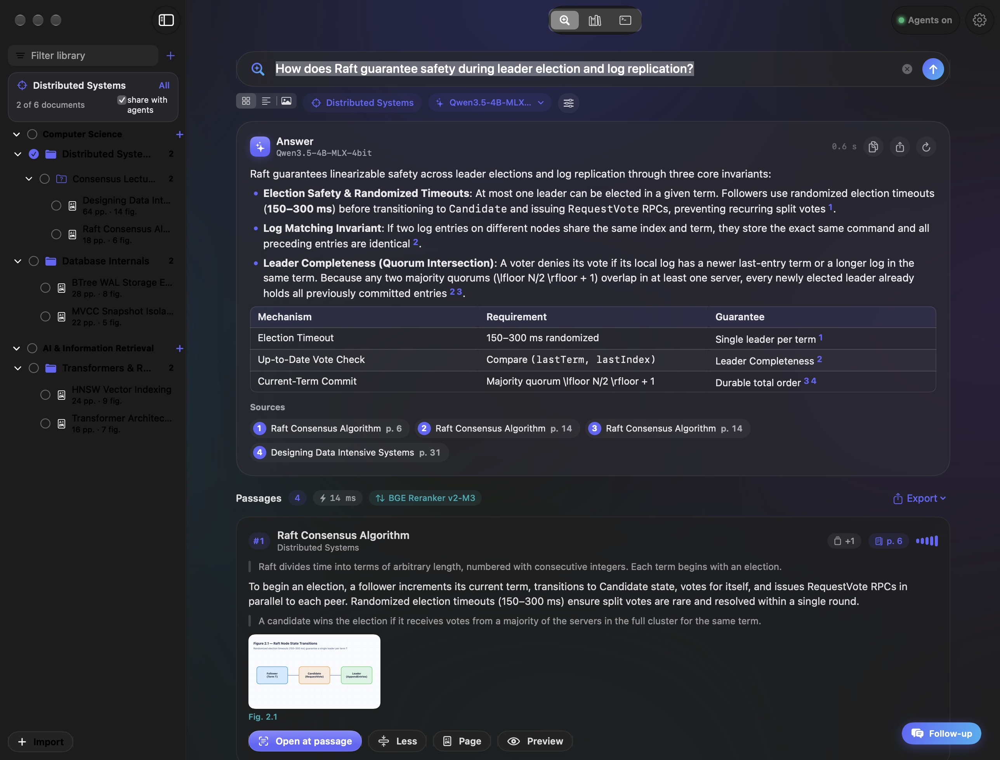
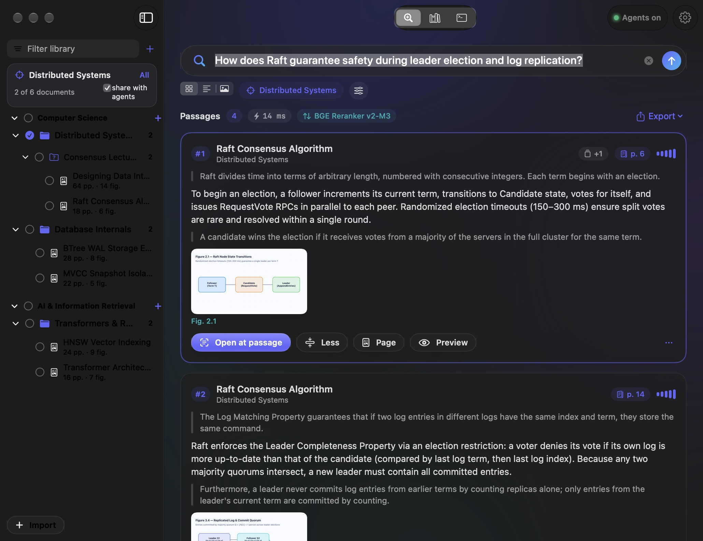
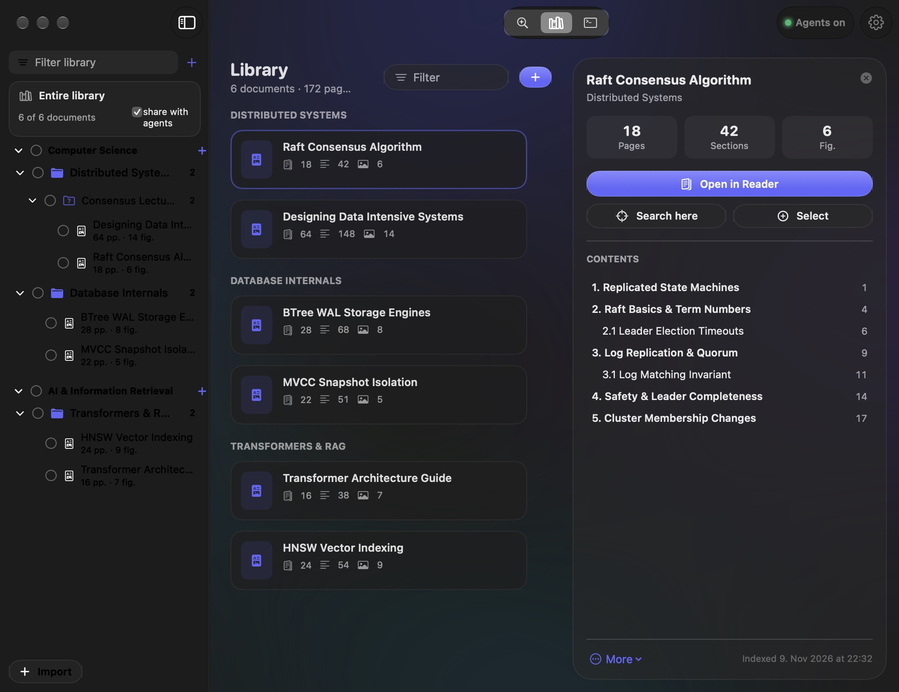
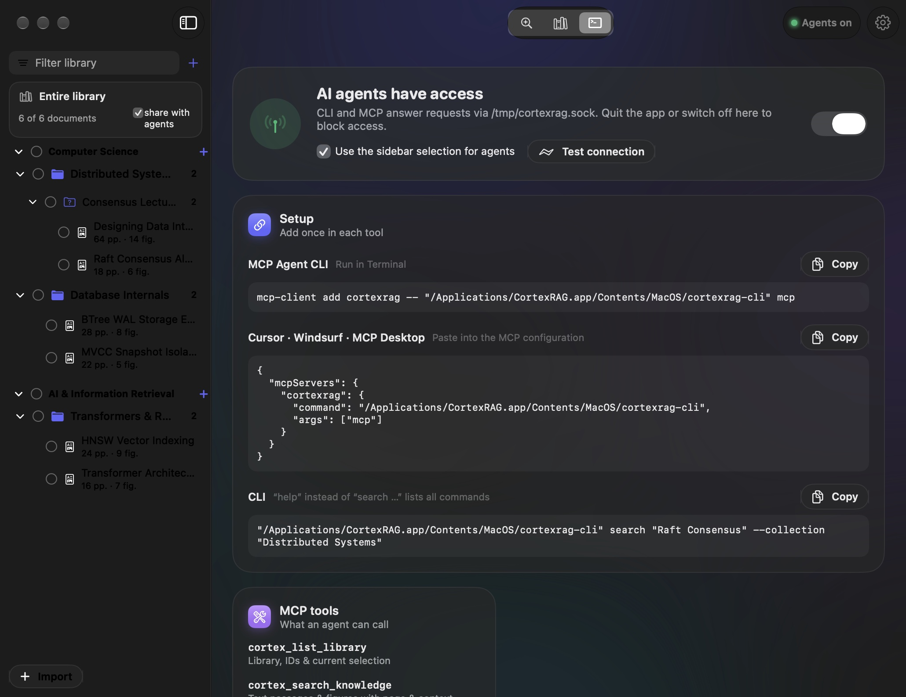
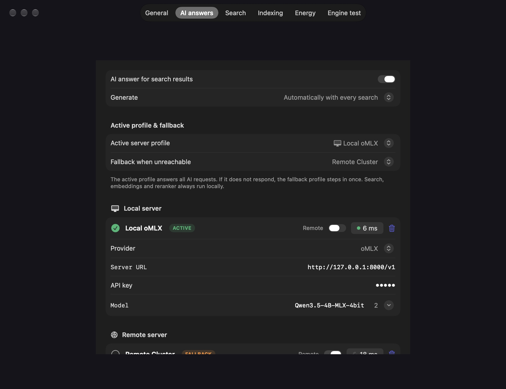

<div align="center">
  
  <h1 align="center">CortexRAG</h1>
  <p align="center"><strong>Local multimodal knowledge base for textbooks, slides and technical documents on macOS.</strong></p>
  <p align="center">Index PDFs, lecture slides and study scripts locally on Apple Silicon — with hybrid vector + BM25 search, Apple Vision figure extraction, cited AI synthesis, and a built-in CLI &amp; MCP server.</p>
  <p align="center">
    <a href="https://github.com/pyMoLt/CortexRAG/releases/latest"></a>
    
    
    
    <a href="LICENSE"></a>
  </p>
</div>

<p align="center">
  
</p>

CortexRAG turns folders of PDFs, lecture slides, and technical books into a fast, searchable local knowledge base on your Mac. Text passages and visual figures are embedded on-device with **Google EmbeddingGemma 2** (`llama.cpp` Metal or **MLX Swift**), stored in a local SQLite + FTS5 database, and queried in milliseconds — with optional cross-encoder reranking, streaming AI synthesis with clickable `[1]`, `[2]` citations, and a zero-config **CLI & MCP server** for coding agents.

---

## Features

- **Hybrid Search & RRF Fusion** — Combines 768-dimensional Matryoshka vector embeddings (`EmbeddingGemma 2`) with SQLite FTS5 BM25 keyword scoring via Reciprocal Rank Fusion (RRF). Adjacent hits from the same document are automatically merged with surrounding context.
- **Figure Extraction & Visual Search** — Renders PDF pages and uses **Apple Vision** layout analysis to detect, crop, and deduplicate diagrams, charts, and tables. Both full slides and individual figure crops can be embedded with the multimodal vision projector and searched alongside text.
- **Library & Hierarchical Folder Tree** — Organize documents into **Areas** (*Bereiche*), **Topics** (*Themen*), and watched folders. Imported folder hierarchies are mirrored in the sidebar with multi-level checkboxes to scope any search to a single PDF, subfolder, topic, or area. Original files stay in place and are never duplicated.
- **Instant Peek & Built-in PDF Reader** — Press <kbd>Space</kbd> on any search hit for an instant Quick-Look-style preview with Up/Down navigation, or press <kbd>Return</kbd> to open the built-in PDF Reader with exact multi-line passage highlighting, outline navigation, and extracted figure thumbnails.
- **Local & Remote AI Server Profiles** — Stream structured answers with inline `[1]`, `[2]` citations and multi-turn KV-cached follow-up questions from any OpenAI-compatible endpoint (`oMLX`, `LM Studio`, `Ollama`), with automatic failover between local and remote LAN/Tailscale profiles.
- **CLI & MCP Server for Coding Agents** — Ships with `cortexrag-cli` inside the app bundle (`stdio` JSON-RPC 2.0 MCP server + CLI). Toggle agent access on or off directly from the app toolbar; when active, agents can search text and figures, inspect tables of contents, expand surrounding chunks, or receive base64-encoded diagram crops.

<p align="center">
  
  
</p>
<p align="center">
  
  
</p>

---

## Models and Engines

Embeddings and cross-encoder reranking run **100% locally on Apple Silicon** via Metal or MLX. Model weights are downloaded on demand into `~/Library/Application Support/CortexRAG/Models/` during first-launch setup or from Settings.

| Component | Model / Engine | Size | Role |
| :--- | :--- | ---: | :--- |
| **Text Embeddings** | `EmbeddingGemma 2` (300M, Q8_0 GGUF / MLX) | ~310 MB | Multilingual 768D / 512D / 256D Matryoshka text vectors (`llama.cpp` Metal or MLX Swift) |
| **Vision Projector** | `EmbeddingGemma 2 mmproj` (SigLIP, Q8_0 / BF16) | ~555 MB | Multimodal image embeddings for slides, diagrams, and charts |
| **Lexical Reranker** | `Cortex Neural-Lexical Cross-Scorer` | 0 MB | Built-in phrase, token, and numeric unit boost (< 2 ms latency) |
| **Neural Reranker** *(optional)* | `BAAI/bge-reranker-v2-m3` (Q8_0 GGUF) | ~635 MB | Multilingual cross-attention reranker for technical & academic terminology |
| **Neural Reranker** *(optional)* | `Qwen/Qwen3-Reranker-0.6B` (Q8_0 GGUF) | ~639 MB | Fast 0.6B cross-encoder optimized for Apple Silicon Metal |
| **AI Synthesis** *(optional)* | OpenAI-compatible Server (`oMLX`, `LM Studio`, `Ollama`) | External | Streams cited answers (`[1]`, `[2]`), reasoning blocks (`<think>`), and vision inputs |

---

## Install

### Download a release

1. Download **`CortexRAG-1.0.0-macos-arm64.zip`** from the [latest release](https://github.com/pyMoLt/CortexRAG/releases/latest).
2. Unzip the archive and drag **CortexRAG.app** into `/Applications`.
3. Because the release build is **ad-hoc signed** (not notarized with a paid Apple Developer ID), macOS Gatekeeper will quarantine the downloaded app on first launch. Clear the quarantine attribute in Terminal:

```bash
xattr -dr com.apple.quarantine /Applications/CortexRAG.app
```

Alternatively, right-click **CortexRAG.app** in `/Applications`, choose **Open**, and click **Open Anyway** under **System Settings → Privacy & Security**.

### First launch

On first launch, the Setup Assistant initializes `~/Library/Application Support/CortexRAG/`, downloads **Google EmbeddingGemma 2** (~865 MB total for text + vision), and lets you optionally configure a cross-encoder reranker and your local or remote OpenAI-compatible LLM server (`http://127.0.0.1:8000/v1`, `http://127.0.0.1:1234/v1`, or `http://127.0.0.1:11434/v1`).

---

## CLI and MCP

`CortexRAG.app` embeds `cortexrag-cli` at `/Applications/CortexRAG.app/Contents/MacOS/cortexrag-cli`. Both the CLI and the MCP server communicate with the running app over a Unix domain socket (`/tmp/cortexrag.sock`) — quitting the app or flipping the **Agents** switch immediately revokes external access.

### Command-line usage

```bash
CLI="/Applications/CortexRAG.app/Contents/MacOS/cortexrag-cli"

# Inspect library hierarchy, document counts, and active UI scope
"$CLI" status

# Hybrid search (text + figures) with compact JSON output for scripts/agents
"$CLI" search "distributed consensus raft leader election" --collection "Distributed Systems" --top-k 6 --compact

# Search extracted figures and diagrams only
"$CLI" figures "state machine replication diagram" --top-k 5

# Crop and retrieve all figures on a specific PDF page
"$CLI" page-figures "Distributed_Systems" --page 14 --compact

# Read full indexed text of a page range or expand context around a chunk
"$CLI" read "Distributed_Systems" --pages 10-14
"$CLI" expand <chunk_id> --before 2 --after 2
```

### MCP server configuration

Add `cortexrag-cli` with the `mcp` subcommand to any MCP-compatible coding agent or IDE (`mcpServers` configuration):

```json
{
  "mcpServers": {
    "cortexrag": {
      "command": "/Applications/CortexRAG.app/Contents/MacOS/cortexrag-cli",
      "args": ["mcp"]
    }
  }
}
```

Exposed read-only MCP tools include `cortex_list_library`, `cortex_search_knowledge` (with `chunk_granularity`, `max_chars_per_chunk`, `min_score`, and `include_base64_images`), `cortex_search_figures`, `cortex_get_page_figures`, `cortex_expand_context`, `cortex_read_pages`, and `cortex_get_document_overview`.

---

## Privacy

| Data | Where it lives | Leaves your Mac? |
| :--- | :--- | :--- |
| **Original PDFs & slides** | In their original folders on disk (linked, never copied) | No |
| **SQLite index & vectors** | `~/Library/Application Support/CortexRAG/Database/cortexrag.sqlite` | No |
| **Rendered pages & figure crops** | `~/Library/Application Support/CortexRAG/Assets/{Pages,Figures}/` | No |
| **Embedding & reranker weights** | `~/Library/Application Support/CortexRAG/Models/` | Downloaded once from Hugging Face |
| **AI synthesis prompts** | Sent only to your configured OpenAI-compatible server (`127.0.0.1` or LAN/Tailscale host) | Only if you configure a remote server |
| **Telemetry / analytics** | None | Never |

---

## Build from source

Requirements: **macOS 15.0+** (Sequoia or later), **Apple Silicon** (`arm64`), **Xcode 16+** with Command Line Tools, `cmake`, and `python3`.

```bash
git clone https://github.com/pyMoLt/CortexRAG.git
cd CortexRAG

# Build static llama.cpp Metal libraries, compile Release targets, and create build/CortexRAG.app
./Scripts/build-app.sh

# Run the test suite
swift test
```

### Project structure

| Path | Description |
| :--- | :--- |
| `Sources/CortexCore/` | SQLite + FTS5 database, hybrid search & RRF fusion, text/caption cleaning, reranker, LLM streaming client, settings |
| `Sources/CortexEmbedders/` | `llama.cpp` Metal C-API bridge and `MLX Swift` backend for `EmbeddingGemma 2` (text + vision) and GGUF cross-encoders |
| `Sources/CortexVision/` | PDFKit + Apple Vision layout analysis, slide vs. prose heuristics, figure cropping, and adaptive image vector pipeline |
| `Sources/CortexIPC/` | Unix domain socket server/client (`cortex.sock`) connecting the macOS app with `cortexrag-cli` and MCP agents |
| `Sources/CortexRAGApp/` | Native SwiftUI macOS interface (Ask view, PDF Reader with passage highlighting, Figures gallery, Library sidebar, Agents, Settings) |
| `Sources/cortexrag-cli/` | Command-line interface and `stdio` JSON-RPC 2.0 Model Context Protocol (MCP) server |
| `Scripts/` | Build scripts (`build-app.sh`, `build-llama-metal.sh`) and English localization generator (`translations_en.py`) |
| `Tests/CortexRAGTests/` | Unit tests for hybrid search, scope filtering, text/caption cleaning, chunk location, and settings migration |

---

## Versions

See [CHANGELOG.md](CHANGELOG.md) for detailed release notes.

| Version | Highlights |
| :--- | :--- |
| **1.0.0** | Initial public release: hybrid dense + BM25 search (`EmbeddingGemma 2`), Apple Vision figure extraction, built-in PDF Reader with chunk highlighting, local/remote LLM server profiles with KV-cached follow-ups, English & German UI, and `cortexrag-cli` / MCP server. |

---

## Credits and license

Built with [llama.cpp](https://github.com/ggml-org/llama.cpp), [MLX Swift](https://github.com/ml-explore/mlx-swift), and Google's [EmbeddingGemma 2](https://huggingface.co/google/embeddinggemma-300m).

Released under the [MIT License](LICENSE).
